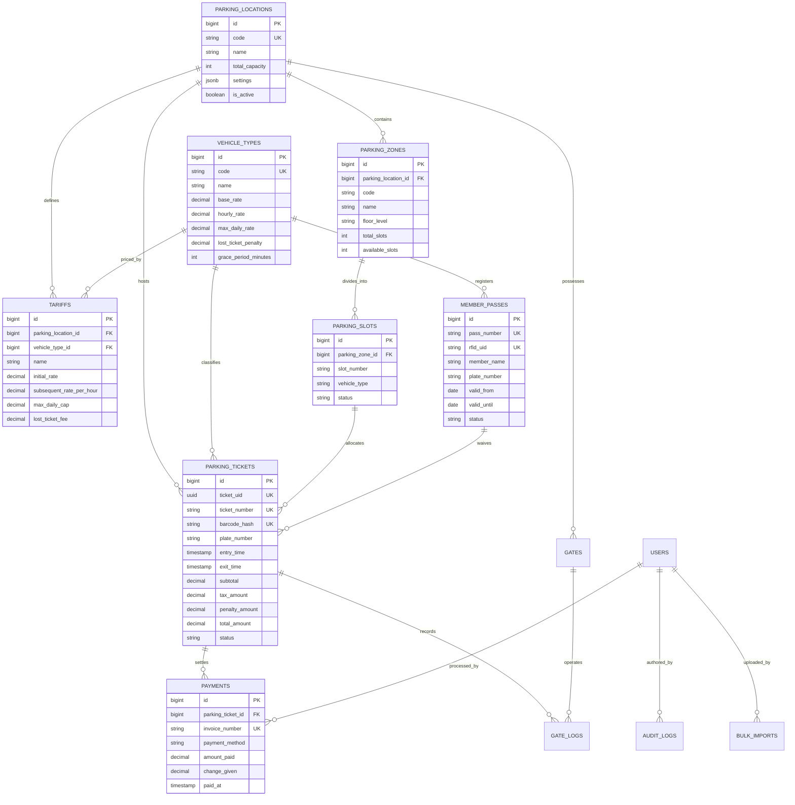

# Intelligent Enterprise Parking Management System

[](https://laravel.com)
[](https://www.postgresql.org)
[](https://getbootstrap.com)
[](https://github.com)

An enterprise-grade, production-ready **Parking Management System (PMS)** web application modelled after premier industry platforms like **Secure Parking**, **CentrePark**, **PARKEE**, and **IN-Parking**.

It delivers comprehensive multi-site vehicle access control, Automated License Plate Recognition (ANPR) simulation, progressive tariff pricing, cashier point-of-sale (POS) terminal, RFID member pass management, parking enforcement, financial analytics, and a high-performance **Admin Bulk Data Import Center**.

Designed specifically for modern deployment on **Laravel 13** and **PostgreSQL 18** with **zero external CDN dependencies** (all Bootstrap and icon libraries are bundled directly inside the project folder for air-gapped, isolated intranet environments).

---

## Table of Contents

- [Key Enterprise Features](#key-enterprise-features)
- [System Architecture & Technology Stack](#system-architecture--technology-stack)
- [Database Schema & ERD](#database-schema--erd)
- [Air-Gapped & Offline Intranet Ready](#air-gapped--offline-intranet-ready)
- [Installation & Setup Guide](#installation--setup-guide)
  - [Setup with Laragon & PostgreSQL 18](#setup-with-laragon--postgresql-18)
  - [Immediate Local Testing with SQLite Mode](#immediate-local-testing-with-sqlite-mode)
- [Pre-Seeded Demo Credentials](#pre-seeded-demo-credentials)
- [Admin Bulk Data Import Specifications](#admin-bulk-data-import-specifications)
- [Standard Operating Procedures (SOP)](#standard-operating-procedures-sop)
- [Running Automated Tests](#running-automated-tests)
- [License & Credits](#license--credits)

---

## Key Enterprise Features

### 1. Operations Dashboard
- **Real-Time KPIs**: Current occupancy rate percentage, total capacity, available bays, today's gross revenue, check-in and checkout traffic counts, active wheel clamps, and registered members.
- **Visual Floor & Zone Occupancy**: Color-coded progress meters showing occupancy density across basement levels, ground floors, and VIP sectors.
- **Vehicle Category Gauges**: Live counters for Sedans, Motorcycles, SUVs, EVs (with charging station status), Trucks, and Buses.
- **Hourly Traffic Flow**: Inbound vs. Outbound traffic tracking from 06:00 to 22:00.
- **Hardware Barrier Status**: Live status monitors for entry and exit barrier gates.

### 2. Entry Terminal (ANPR Simulator)
- **Automatic License Plate Recognition (ANPR)**: Simulated 1080p camera feed overlay with AI optical character recognition and confidence score.
- **Vehicle Ingestion**: Category selector, gate barrier assignment, zone and bay allocation.
- **Ticket Dispenser**: Generates unique UUIDs, sequential ticket numbers (e.g. `TKT-20261015-0001`), and printable barcode hashes with a thermal print modal.
- **One-Click Random Plate Generator**: Facilitates rapid cashier and gate operator testing.

### 3. Exit Cashier POS & Self-Service Settlement
- **Barcode & Plate Scanner**: Instant lookup by scanning barcode hash, ticket number, or license plate.
- **Intelligent Fee Calculation Engine**:
  - Enforces free drop-off grace period (e.g. first 15 minutes $0.00).
  - Progressive hourly rates (first hour base charge + incremental subsequent hourly billing).
  - 24-hour maximum daily charge cap.
  - Automatic 10% VAT / municipal service tax breakdown.
  - Active Member Pass recognition (automatically waives parking fee).
- **Multi-Tender POS**:
  - Cash payment with quick tender buttons ($10, $20, $50, $100, Exact) and real-time change calculation.
  - Digital payments: QRIS / E-Wallet, Credit Card (Visa/Mastercard), Debit Card.
  - Official tax invoice and payment receipt generation with thermal print layout.

### 4. Lost Ticket Recovery Affidavit Wizard
- Standard Operating Procedure (SOP) for patrons who misplace entry slips.
- Capture driver identity (Full Name, Government ID / Driver's License No, Phone).
- Computes vehicle-specific lost ticket penalty fee + duration tariff + 10% VAT.
- Issues exit clearance pass, records affidavit in audit logs, and opens the exit barrier.

### 5. Membership Passes & RFID Subscriptions
- Manages monthly, quarterly, annual, and VIP complimentary passes.
- Tracks RFID card UIDs, assigned license plates, and subscription validity windows.
- Visual badge indicators: **Active**, **Expiring Soon** (<= 7 days countdown), and **Expired**.
- Rapid subscription renewal dialog with duration choices (1, 3, 6, 12 months) and revenue tracking.

### 6. Parking Zones & Bays Visualizer
- Visual grid layout of physical parking bays.
- Color status indicators:
  - <span style="color:#10b981;font-weight:bold;">Green</span>: Available for parking
  - <span style="color:#ef4444;font-weight:bold;">Red</span>: Occupied (shows parked vehicle plate on hover)
  - <span style="color:#f59e0b;font-weight:bold;">Yellow</span>: Reserved for VIP / Tenants
  - <span style="color:#64748b;font-weight:bold;">Grey</span>: Maintenance / Out of service
- Quick slot status toggle modal with occupancy validation.

### 7. Tariff Configuration & Pricing Rules
- Multi-tier tariff rules per vehicle type and parking facility.
- Configurable parameters: initial duration, initial rate, subsequent rate per hour, 24h daily cap, overnight surcharge, lost ticket penalty, and free grace period minutes.

### 8. Parking Enforcement & Violations
- Log parking violations: unauthorized VIP slot parking, overstay beyond allowed grace, blocking driveways, and missing tickets.
- **Wheel Clamping Protocol**: Attach or release wheel clamps with mandatory officer reason logging.
- Fine collection and fee waiver audit tracking.

### 9. Admin Bulk Data Ingestion Center
- High-volume CSV ingestion for enterprise onboarding:
  1. **Parking Slots & Bays** (`slots`): Ingest hundreds of bays mapped to zone codes and vehicle types.
  2. **Member Passes** (`members`): Bulk import tenant subscriptions and RFID cards.
  3. **Tariff Rates** (`tariffs`): Bulk configure pricing policies across multiple locations.
  4. **Registered / Whitelisted Vehicles** (`vehicles`): Import company and VIP whitelist vehicles.
- Pre-formatted downloadable CSV sample templates for each module.
- Row-by-row error detection and transaction safety.
- Historical import log table with error telemetry.

### 10. Financial Reports & Analytics
- Date-range filtering for revenue auditing.
- Payment method share breakdown (Cash, QRIS, Credit Card, Debit Card).
- Revenue breakdown by vehicle category.
- Daily revenue and traffic trends.
- **Export to CSV**: Downloadable official financial audit spreadsheet.

---

## System Architecture & Technology Stack

```
+--------------------------------------------------------------------------+
|                   Enterprise Parking Management System                   |
+--------------------------------------------------------------------------+
|  Presentation Layer:                                                     |
|    - Blade Templates (Bootstrap 5.3.3 + Bootstrap Icons 1.11.3)          |
|    - 100% Offline / Intranet Assets in /public/vendor                    |
|    - Responsive POS Layouts & Thermal Print Simulator (58mm / 80mm)      |
+--------------------------------------------------------------------------+
|  Application & Domain Layer (Laravel 13):                                |
|    - Auth & Role Middleware (admin, manager, cashier, patrol)            |
|    - GateController (ANPR Check-in, POS Checkout, Barrier Control)       |
|    - Tariff Calculation Engine (Progressive, Grace, Daily Caps, Lost)    |
|    - BulkImportService (CSV Parser, Data Validation, DB Transactions)    |
|    - AuditLog & GateLog Observers                                        |
+--------------------------------------------------------------------------+
|  Persistence Layer (PostgreSQL 18 / SQLite):                             |
|    - PostgreSQL 18 with JSONB settings, UUIDs, and Indexing             |
|    - Foreign Keys with CASCADE / NULL ON DELETE integrity                |
+--------------------------------------------------------------------------+
```

---

## Database Schema & ERD



---

## Air-Gapped & Offline Intranet Ready

Many high-security commercial facilities (airports, military bases, high-rise office towers, shopping malls) run their parking management system strictly within an isolated local network (LAN / VLAN) without external internet access.

The application is built to be **100% independent of external CDNs**:
- **Bootstrap 5.3.3**: Stored in `public/vendor/bootstrap/css/bootstrap.min.css` and `public/vendor/bootstrap/js/bootstrap.bundle.min.js`.
- **Bootstrap Icons 1.11.3**: Stored in `public/vendor/bootstrap-icons/bootstrap-icons.min.css` and local font files (`.woff2`, `.woff`) in `public/vendor/bootstrap-icons/fonts/`.
- All CSS and JS files are referenced using native Laravel `{{ asset('vendor/...') }}` helpers.

---

## Installation & Setup Guide

### Setup with Laragon & PostgreSQL 18

When deploying to Laragon with PostgreSQL 18:

1. **Place Project in Web Root**:
   Extract or clone the project folder into your Laragon web directory:
   ```powershell
   # Typically C:\laragon\www\parking-management-system
   ```

2. **Configure PostgreSQL 18 in Laragon**:
   - Ensure PostgreSQL 18 service is enabled in Laragon (`Menu > PostgreSQL > Start`).
   - Create the target database using `psql`, HeidiSQL, or pgAdmin:
     ```sql
     CREATE DATABASE parking_db;
     ```

3. **Verify Environment Settings (`.env`)**:
   The `.env` is pre-configured for PostgreSQL 18:
   ```env
   APP_NAME="Parking Management System"
   APP_ENV=local
   APP_KEY=base64:0SKUkbQTS4+4Ja/nj02QS2jX1Af6WGRWm7DSBZ5cZbQ=
   APP_DEBUG=true
   APP_URL=http://localhost:8000

   DB_CONNECTION=pgsql
   DB_HOST=127.0.0.1
   DB_PORT=5432
   DB_DATABASE=parking_db
   DB_USERNAME=postgres
   DB_PASSWORD=postgres
   DB_SSLMODE=prefer
   ```

4. **Run Migrations and Seed Database**:
   Open Laragon Terminal (or PowerShell) and execute:
   ```powershell
   php artisan migrate:fresh --seed
   ```

5. **Start Application**:
   ```powershell
   php artisan serve
   ```
   Open your browser and navigate to: `http://localhost:8000`

---

### Immediate Local Testing with SQLite Mode

If PostgreSQL 18 is not yet installed on your development machine, you can run and test all features instantly using the pre-configured SQLite mode:

1. **Activate SQLite Configuration**:
   ```powershell
   Copy-Item .env.sqlite .env -Force
   ```

2. **Run Migrations & Seeders**:
   ```powershell
   php artisan migrate:fresh --seed
   ```

3. **Launch the Development Server**:
   ```powershell
   php artisan serve
   ```
   Visit `http://localhost:8000` in your web browser.

---

## Pre-Seeded Demo Credentials

The database seeder pre-populates four realistic enterprise staff roles with password `password`. The login page also provides one-click quick login buttons for convenience:

| Role | Name | Email / Badge ID | Password | Access Privileges |
| :--- | :--- | :--- | :--- | :--- |
| **Super Admin** | Alexander Vance | `admin@parking.local` (or `BADGE-ADM-001`) | `password` | Full system control, Bulk Import Center, Financial Reports, Tariffs |
| **Site Manager** | Sarah Jenkins | `manager@parking.local` (or `BADGE-MGR-002`) | `password` | Tariff rate adjustment, bay allocation, discount overrides, reports |
| **Gate Cashier** | David Miller | `cashier@parking.local` (or `BADGE-CSH-003`) | `password` | Entry ANPR terminal, Exit POS terminal, payment collection, receipts |
| **Patrol Marshall** | Marcus Thorne | `patrol@parking.local` (or `BADGE-PTR-004`) | `password` | Parking violations, wheel clamping, enforcement inspections |

---

## Admin Bulk Data Import Specifications

The Bulk Import Center (`/admin/bulk-import`) allows system administrators to import large datasets via standard CSV files.

### 1. Parking Bays / Slots Import (`slots`)
Template file: `public/templates/slots_template.csv`
```csv
zone_code,slot_number,vehicle_type,notes
B1-A,B1-A21,car,Basement 1 Sector A Standard Bay
B1-A,B1-A22,car,Basement 1 Sector A Standard Bay
B1-EV,EV-1011,ev,150kW CCS2 Fast Charger
GF-MOTOR,M-31,motorcycle,Ground Floor Two-Wheeler Bay
L1-VIP,VIP-11,car,Level 1 Executive Valet
```

### 2. Member Passes Import (`members`)
Template file: `public/templates/members_template.csv`
```csv
pass_number,rfid_uid,member_name,phone,email,plate_number,vehicle_type_code,plan_type,price_paid,valid_from,valid_until,notes
MEM-2026-101,E280116060000301,Jonathan Davis,+1-555-1234,jdavis@example.com,B 4567 ABC,car,monthly,120.00,2026-10-01,2026-10-31,Tenant Suite 302
MEM-2026-102,E280116060000302,Samantha Wright,+1-555-5678,swright@example.com,B 7890 DEF,ev,annual,1300.00,2026-10-01,2027-09-30,Executive VIP
```

### 3. Tariff Rates Import (`tariffs`)
Template file: `public/templates/tariffs_template.csv`
```csv
location_code,vehicle_type_code,tariff_name,tariff_type,initial_duration_minutes,initial_rate,subsequent_rate_per_hour,max_daily_cap,overnight_surcharge,lost_ticket_fee,grace_period_minutes
MGC-01,car,Weekend Special Sedan Rate,progressive,60,6.00,3.50,45.00,20.00,50.00,15
MGC-01,ev,Green Commuter EV Promo,progressive,60,3.50,2.00,28.00,15.00,40.00,20
```

### 4. Registered / Whitelisted Vehicles Import (`vehicles`)
Template file: `public/templates/vehicles_template.csv`
```csv
plate_number,vehicle_type_code,owner_name,notes
B 3322 VIP,car,CEO Company Vehicle,Authorized Level 1 VIP Access
B 5544 MTR,motorcycle,Dispatch Staff Unit 1,Free Entry Gate Access
```

---

## Standard Operating Procedures (SOP)

### Inbound Vehicle Check-in (Entry Terminal)
1. Navigate to **Entry Terminal (ANPR)** from the sidebar.
2. Enter the license plate number (or click the shuffle button for random test generation).
3. Select the vehicle category (Car, Motorcycle, EV, SUV, Truck, Bus).
4. Click **Dispense Ticket & Raise Barrier Gate**.
5. The system logs the event in `gate_logs`, reserves the bay, and displays a printable barcode ticket slip.

### Outbound Vehicle Checkout (Cashier POS)
1. Navigate to **Exit Cashier POS** from the sidebar.
2. Scan the ticket barcode or type the plate number in the lookup bar.
3. The pricing engine displays:
   - Total elapsed duration.
   - Grace period exemption status (if <= 15 minutes, fee is $0.00).
   - Member pass waiver status (if active member, fee is $0.00).
   - Progressive hourly rate breakdown + 10% VAT.
4. Select the payment method (Cash, QRIS/E-Wallet, Card).
5. For cash, input the tendered amount or click a quick tender button ($20, $50, etc.). The system calculates change.
6. Click **Complete Settlement & Raise Exit Barrier**.
7. The bay is marked available, the exit gate clears, and an official tax invoice receipt is displayed.

### Lost Ticket Resolution
1. Navigate to **Lost Ticket Wizard** from the sidebar.
2. Enter the vehicle license plate number and select vehicle category.
3. Capture the driver's ID number and contact phone.
4. The system automatically calculates the flat lost ticket penalty fee (e.g. $50.00) plus tax.
5. Process payment and click **Affirm Affidavit, Collect Fine & Raise Barrier**.

---

## Running Automated Tests

The application comes with automated PHPUnit feature and unit test suites:

```powershell
php artisan test
```

Expected test results:
```text
   PASS  Tests\Unit\ExampleTest
  ✓ that true is true

   PASS  Tests\Feature\ExampleTest
  ✓ the application returns a successful response

   PASS  Tests\Feature\ParkingSystemTest
  ✓ login page renders successfully
  ✓ user can authenticate and access dashboard
  ✓ vehicle checkin creates ticket and gate log
  ✓ vehicle checkout calculates fees and processes payment
  ✓ admin bulk import slots
  ✓ role middleware restricts unauthorized users

  Tests:    8 passed (16 assertions)
```

---

## License & Credits

Developed with excellence for modern parking facility infrastructure.
Built on **Laravel 13**, **PostgreSQL 18**, and **Bootstrap 5.3**.
All rights reserved © 2026 Enterprise Parking System.
